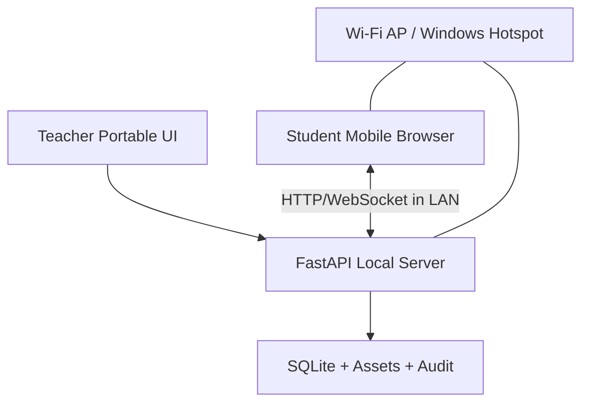

# Architecture v1 — Single-Host Offline LAN

## 1. Ranh giới hệ thống



- Teacher mở `ExamGuard.exe`, launcher kiểm tra cấu hình/dữ liệu, migrate có backup, khởi chạy server chỉ khi được phép, mở UI cục bộ.
- Điện thoại vào cùng AP/router (router không cần WAN). Địa chỉ server hiển thị động theo interface local, ví dụ `http://192.168.x.y:<port>`; QR tương ứng.
- Teacher UI và Student UI dùng frontend bundled; server xác thực quyền. Không expose đường quản trị qua LAN nếu không cần; teacher admin chỉ localhost hoặc auth mạnh + chính sách bind.
- Internet không phải dependency; endpoint traffic trong LAN. Nếu Windows firewall chắn, hiển thị hướng dẫn cấp quyền hợp lệ.

## 2. Stack mục tiêu

| Layer | Công nghệ | Lý do/quy tắc |
| --- | --- | --- |
| Local backend | Python 3.12+, FastAPI, Pydantic v2 | ASGI/WebSocket, typed DTO, dễ tích hợp parser |
| Storage | SQLite WAL, SQLAlchemy 2 + Alembic | Một writer local, transaction, migration + backup |
| Frontend | React, TypeScript strict, Vite, Tailwind | SPA teacher/student build static bundled, không CDN |
| Realtime | WebSocket + HTTP resync | Presence/control; HTTP là nguồn chắc cho save/submit |
| Desktop shell | PyWebView hoặc mở browser localhost (đánh giá P0) | Tránh ép yêu cầu engine nặng; không dùng Electron mặc định |
| Word parser | python-docx + OOXML/lxml + image store | Giữ rich structure, OMML, table |
| PDF parser | PyMuPDF (license review trước release) | Text blocks, render vector/scan crop |
| Math | MathML/LaTeX + local KaTeX assets | Không tải CDN; fallback crop image |
| Excel/PDF | openpyxl, reportlab hoặc equivalent | Export/import offline, stream file |
| OMR P2 | OpenCV + deskew/alignment | Human review khi confidence thấp |
| Package | PyInstaller onedir đầu tiên | Portable folder, ít lỗi unpack hơn onefile |
| Tests | pytest, httpx, Playwright/Vitest, Locust/k6 | Domain, API, E2E, load |

Đánh giá license PyMuPDF, fonts, KaTeX, icon assets trước khi phân phối; cân nhắc thư viện khác nếu không tương thích mục tiêu giấy phép.

## 3. Code modules và ranh giới

```text
backend/app/
  api/             # auth, classrooms, students, questions, exams, sessions, receipts, exports
  realtime/        # presence websocket, broadcasts, bounded message queue
  domain/          # pure exam state machine, scoring, shuffling, policy
  services/        # orchestrate transactions, teacher commands, publication
  converters/      # format adapters, layout, classifier, validation, media
  persistence/     # SQLAlchemy models/repos/migrations
  security/        # tokens, access control, audit, hashing, rate limits
  exports/         # PDF/Excel receipts, question booklets
  launcher/        # Windows interface/network discovery and server process
```

Mọi endpoint API gọi service/domain; UI không truy cập DB. Converter không trực tiếp chạm đến official exam records; đầu ra `QuestionDraft` chờ review.

## 4. API route groups (đề xuất, có version)

| Method | Route | Ai dùng | Ghi chú |
| --- | --- | --- | --- |
| GET | `/api/v1/health` | local + LAN | no PII, app version |
| POST | `/api/v1/classes/import` | teacher | validate Excel/CSV, dry-run duplicate report |
| CRUD | `/api/v1/classes`, `/students` | teacher | stable IDs, soft-delete |
| POST | `/api/v1/questions/import` | teacher | async job local, hash source, preview |
| GET | `/api/v1/questions/import/{jobId}` | teacher | progress + errors + preview |
| POST | `/api/v1/questions/{draftId}/approve` | teacher | require all required data valid |
| CRUD | `/api/v1/exams` | teacher | draft config, randomized seed |
| POST | `/api/v1/exams/{id}/transition` | teacher | explicit state transition + audit |
| POST | `/api/v1/room/{code}/join` | student | roster code + per-student secret; pending |
| POST | `/api/v1/attempts/{id}/answers` | student | revision, idempotency, ACK committed |
| POST | `/api/v1/attempts/{id}/submit` | student | idempotent finalization |
| GET | `/api/v1/attempts/{id}/sync` | student | canonical answer state, not key |
| WS | `/ws/v1/room/{roomId}` | both auth | heartbeats, statuses, no key leak |
| POST | `/api/v1/exams/{id}/review` | teacher | finalize scoring snapshot |
| POST | `/api/v1/exams/{id}/publish` | teacher | after session closed + reviewed |
| GET | `/api/v1/receipts/me` | student | only PUBLISHED, own attempt |
| GET | `/api/v1/exams/{id}/export` | teacher | Excel/PDF; sanitized content |

Exact endpoint names finalized during P1 and recorded in API spec; never implement routes without auth, DTO and tests.

## 5. Tách control-plane và exam data

`TeacherToken` có capability admin local. `StudentSessionToken` chỉ cho đúng attempt. Tạo ticket/revocation khi đổi máy. Student token không được nhận `answer_key`, `scoring_rubric`, receipt trước công bố dù request trực tiếp. Không đưa key trong JS bundle, event broadcast hay meta response.

## 6. State machine

```text
EXAM: DRAFT -> READY -> WAITING -> RUNNING -> CLOSED -> REVIEWED -> PUBLISHED -> ARCHIVED
              \-> CANCELLED (with reason)
ATTEMPT: PENDING_APPROVAL -> READY -> ACTIVE -> SUBMITTED | EXPIRED | DISQUALIFIED
PRESENCE: ONLINE -> SUSPECTED -> DISCONNECTED -> RECONNECTED | LOCKED
```

Exam CLOSED khóa thời gian và nhận submit mới theo chính sách xử lý pending đã công bố. Teacher may pause/resume; audit event + server adjusted deadline. Khi network bị ngắt, local browser hiển thị `UNSAVED` nếu chưa ACK; server không nhận answer sau lock trừ khi giáo viên mở/cho sync theo quy trình.

## 7. Realtime + autosave semantics

- Gửi heartbeat (client application-level ví dụ 3s); nếu timeout 5s -> `SUSPECTED`, 15s -> `DISCONNECTED/LOCKED` theo policy. Trình duyệt nền có thể throttling; số này là cấu hình thử nghiệm, không ngưỡng kết luận gian lận.
- WebSocket chỉ broadcast status/countdown/server clock/policy; khi socket chết, HTTP `GET sync` và WebSocket reconnect. Có backoff/jitter và deadline server.
- Answer save: `(attempt_id, question_id, selected_option_ids, client_revision, idempotency_key)` -> transactional upsert với monotonically increasing `server_revision`, ACK server time. Trả lại canonical state khi conflict.
- `submitted_at_server` và snapshot chốt dưới transaction; không cho sửa sau final submit; submit retry trả kết quả cũ.
- Dùng index theo `(attempt_id, question_id)` và unique idempotency key scoped attempt; không ghi mỗi keystroke không cần thiết.

## 8. Lưu trữ và backup

- Data directory có quyền ghi rõ ràng, độc lập binary. Portable folder đề xuất `./ExamGuardData` cạnh exe nếu có quyền; nếu không writable, hỏi người dùng chọn directory, không silently fallback làm mất dữ liệu.
- SQLite WAL, checkpoint khi idle/backup; backup nhất quán qua SQLite backup API, bao gồm asset media/file gốc và manifest checksum.
- Migration Alembic có version và backup trước khi đổi schema; không xóa bảng tự động nếu dữ liệu cũ cần giữ.
- Mọi metadata chứa timestamp UTC ISO8601; UI giờ VN, không tin thời gian client.

## 9. Phân phối kết quả

Sau `PUBLISHED`, phát event `RESULTS_AVAILABLE` không chứa điểm/key; học sinh qua authorized GET nhận receipt. PDF/PNG tạo local; browser cần user chủ động tải. Lưu version, watermark/mã kiểm tra, hash. Nếu key đổi, tạo score/receipt version mới, đánh dấu bản cũ superseded.

## 10. Ràng buộc triển khai

- Không dùng external Redis/Postgres/CDN, OIDC, public domain hoặc tunnel ngầm; build offline artifact.
- Không tự bật hotspot bằng hack admin hoặc chạy lệnh network phá cấu hình của giáo viên. Cho user chọn: AP/router, hoặc Windows Hotspot sau kiểm tra khả năng hỗ trợ.
- Cần test LAN từ hai interface/firewall khác nhau; IP dynamic. Không dùng hardcode `192.168.137.1`.
- Mục tiêu release ban đầu Windows x64 onedir; onefile optional sau khi verify size/startup/perf.

## 11. ADR khi thay đổi

Thay đổi nào liên quan `framework`, DB, protocol, token lifecycle, score schema, converter fidelity hoặc publication policy cần ADR: Context → Decision → Alternatives → Consequences → migration/test impact → approval.
