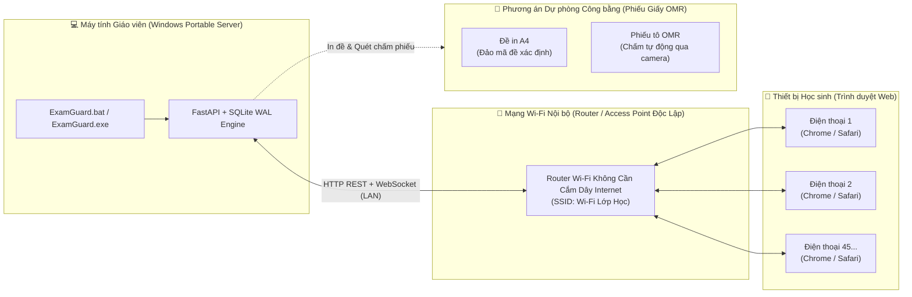

# ExamGuard — Hệ Thống Kiểm Tra Trắc Nghiệm LAN Ngoại Tuyến Cho Trường THPT

<p align="center">
  
  
  
  
  
  
</p>

---

## 1. Giới thiệu tổng quan

**ExamGuard** là phần mềm tổ chức kiểm tra trắc nghiệm ngoại tuyến được thiết kế chuyên biệt cho giáo viên các trường Trung học Phổ thông (THPT) tại Việt Nam.

Phần mềm giải quyết bài toán cốt lõi: **Tổ chức các bài kiểm tra 15 phút, 45 phút, định kỳ và thi thử trong điều kiện phòng học không có Internet hoặc mạng Wi-Fi trường học chập chờn**, đồng thời hỗ trợ phương án in đề và chấm phiếu trắc nghiệm (OMR) song song cho các học sinh không sử dụng điện thoại.

### Mô hình hoạt động — Classroom Mode (1 Lớp · 1 Máy chủ Cục bộ · 0 Internet)



- **Giáo viên:** Chạy ứng dụng từ một thư mục di động (Portable) trên laptop Windows mà không cần cài đặt phức tạp. Laptop giáo viên đóng vai trò máy chủ cục bộ (Local Server) điều phối toàn bộ phiên thi.
- **Học sinh:** Dùng điện thoại thông minh kết nối vào Wi-Fi lớp học, quét mã QR để vào thi trực tiếp trên trình duyệt (Chrome, Safari, Firefox, Edge) — **không cần tải hoặc cài đặt thêm bất kỳ ứng dụng nào**.
- **Không có điện thoại:** Được phát cùng đề thi in giấy A4 và phiếu tô OMR, kết quả được quét và đồng bộ chung vào cùng một bảng điểm của lớp.

---

## 2. Các tính năng cốt lõi

### 🚀 2.1. Windows Portable 1-Click & 100% Offline-First
- **Không cần cài đặt:** Nhấp đúp vào [`ExamGuard.bat`](file:///d:/Project/ExamGuard/ExamGuard.bat) hoặc `ExamGuard.exe` để khởi chạy ngay lập tức; toàn bộ dữ liệu CSDL SQLite WAL, ảnh đề thi, phiếu OMR và biên nhận được lưu trữ gọn trong thư mục `ExamGuardData` bên cạnh ứng dụng.
- **Zero CDN & Không rò rỉ dữ liệu:** 100% phông chữ (`Be Vietnam Pro`, `JetBrains Mono`), công thức toán học (`KaTeX`), biểu tượng (`lucide-react`) và thư viện đều được đóng gói tĩnh cục bộ. Kiểm toán mạng xác nhận **0 kết nối ra ngoài Internet** trong suốt quá trình vận hành.

### 📄 2.2. Nhập đề Đa định dạng & Bảo toàn Nguyên tác (Preservation Engine)
- **Hỗ trợ Microsoft Word (`.docx`):** Bóc tách thông minh các đoạn văn bản có định dạng, bảng biểu số liệu, ảnh nhúng và đặc biệt là **công thức toán học OMML** chuyển đổi mượt mà sang KaTeX/LaTeX.
- **Hỗ trợ Microsoft Excel (`.xlsx`):** Nhập đề từ các bảng tính câu hỏi theo 4 mẫu định dạng phổ biến của giáo viên THPT.
- **Hỗ trợ Adobe PDF (`.pdf`):** Bóc tách đề thi dạng 2 cột, phát hiện biểu đồ vector và cảnh báo đối với các tệp scan thiếu lớp văn bản (`PDF_LOW_TEXT_DENSITY_OCR_NEEDED`).
- **Giao diện đối chiếu song song (Split-View):** Giáo viên trực quan so sánh nội dung thô gốc và bản hiển thị công thức/ảnh. Hệ thống **tuyệt đối không tự suy đoán đáp án** khi phát hiện thiếu key hoặc đánh dấu mập mờ.

### 🔒 2.3. Động cơ Thi Đáng tin cậy & Chống mất dữ liệu (No Silent Data Loss)
- **Cam kết giao dịch an toàn:** Mỗi câu trả lời của học sinh được lưu với `idempotency_key` và chỉ trả về trạng thái `Đã lưu` (ACK) sau khi CSDL SQLite đã thực thi COMMIT hoàn tất.
- **Khả năng tự phục hồi thảm họa:** Nếu máy chủ bị cúp điện hoặc tắt đột ngột, toàn bộ bài làm đã thấy dấu `Đã lưu` được bảo toàn nguyên vẹn nhờ cơ chế SQLite WAL và tự động đồng bộ khi học sinh tải lại trang.
- **Xáo trộn đề bài xác định:** Trộn thứ tự câu hỏi và phương án ngẫu nhiên theo `seed`, bảo toàn chính xác ánh xạ đáp án gốc.

### ⏱️ 2.4. Giám sát Thời gian thực & Công bằng (Fair Monitoring)
- **Đồng hồ máy chủ chuẩn mực (Server-Authoritative):** Thời gian làm bài do máy chủ quyết định; việc học sinh đổi giờ trên điện thoại không làm sai lệch đồng hồ thi.
- **Giám sát nhịp tim (Heartbeat):** Theo dõi kết nối học sinh theo các ngưỡng cấu hình mềm (`SUSPECTED -> DISCONNECTED -> LOCKED_PENDING_REVIEW`).
- **Không suy diễn gian lận tự động:** Sự kiện chuyển tab, ẩn trang hoặc rớt mạng chỉ được ghi nhận như tín hiệu kỹ thuật để giáo viên xem xét và hỗ trợ mở khóa / cộng thêm giờ trong ngăn sự cố minh bạch.

### 📊 2.5. Chấm điểm Tự động, Sửa điểm có Lưu vết & Bảo mật Điểm số
- **Chống lộ đề sớm (No Early Disclosure):** Học sinh không thể xem đáp án đúng hay điểm số trước khi giáo viên duyệt (`REVIEWED`) và bấm phát hành (`PUBLISHED`).
- **Lưu vết phúc khảo minh bạch:** Khi giáo viên điều chỉnh đáp án chuẩn sau buổi thi, hệ thống tự động chấm lại toàn bộ lớp và sinh phiên bản điểm mới (`ScoreVersion v2`), lưu vết lý do và chuỗi kiểm toán `AuditEvent` băm SHA-256 không thể sửa ngầm.
- **Biên nhận cá nhân:** Học sinh được tải biên nhận điện tử PDF và thẻ chia sẻ ảnh PNG có che thông tin nhạy cảm (PII).
- **Xuất bảng điểm Excel an toàn:** Tự động khử độc các ký tự nguy hiểm (`=`, `+`, `-`, `@`) để chống tấn công chèn mã độc vào bảng tính (Formula Injection — `CWE-1236`).

### 🖨️ 2.6. Cầu nối Đề Giấy A4 & Chấm Phiếu OMR Bằng Thị Giác Máy Tính
- **Sinh đề in giấy đa mã đề:** Tạo các bản in đề thi A4 chuẩn phông tiếng Việt (`DejaVuSans.ttf`) từ cùng ngân hàng câu hỏi.
- **Phiếu trả lời trắc nghiệm chuẩn:** Sinh phiếu tô A4 40–50 câu có 4 điểm định vị góc (corner markers) và khối nhận diện mã học sinh, mã đề.
- **Bộ xử lý OMR thông minh:** Sử dụng thuật toán nắn góc phối cảnh (homography rectification) từ ảnh chụp camera điện thoại, tự động đo độ tương phản ô tô, gắn cờ cảnh báo các ô tô đúp hoặc nét mờ đưa về giáo viên xác nhận trước khi đưa vào bảng điểm chung.

---

## 3. Cấu trúc thư mục dự án

```text
ExamGuard/
├── backend/                     # Máy chủ FastAPI, SQLite WAL, Alembic migrations & Pytest
│   ├── app/
│   │   ├── api/                 # Endpoints REST (auth, classes, questions, exams, results, paper)
│   │   ├── converters/          # Pipeline bóc tách DOCX/OMML, PDF 2 cột, Excel câu hỏi
│   │   ├── domain/              # Máy trạng thái kỳ thi, thuật toán xáo trộn và chấm điểm
│   │   ├── services/            # Nghiệp vụ phòng thi, giám sát nhịp tim, OMR, sao lưu
│   │   └── db/models.py         # CSDL SQLAlchemy 2.0 (15+ bảng quan hệ chặt chẽ)
│   ├── alembic/                 # 7 bản migrations nâng cấp CSDL an toàn
│   └── tests/                   # 33 bài test tự động bao phủ từ P0 đến P7
│
├── frontend/                    # Giao diện SPA React 18, TypeScript Strict, Tailwind CSS
│   ├── src/
│   │   ├── pages/teacher/       # Quản lý lớp, duyệt đề, phòng chờ QR, giám sát, OMR, phúc khảo
│   │   ├── pages/student/       # Trang vào phòng, giao diện làm bài thi di động, xem kết quả
│   │   └── components/          # Hiển thị toán KaTeX, huy hiệu trạng thái, điều hướng
│   └── dist/                    # Bản build tĩnh độc lập nhúng kèm vào gói Portable
│
├── desktop/                     # Bộ khởi chạy Windows Desktop
│   ├── launcher.py              # Xử lý vòng đời tiến trình, tìm cổng rảnh, nâng cấp CSDL
│   └── examguard.spec           # Cấu hình đóng gói PyInstaller onedir
│
├── tools/                       # Kịch bản tự động hóa & Kiểm thử chất lượng
│   ├── build_portable.ps1       # Tự động đóng gói bản dựng Portable release ZIP
│   ├── verify.ps1               # Chạy toàn bộ suite kiểm tra (ruff, mypy, pytest, eslint, tsc, vitest)
│   ├── load_test.py             # Công cụ đo kiểm tải 45 học sinh ảo đồng thời
│   └── generate_sample_fixtures.py # Tự động tạo dữ liệu mẫu thực tế
│
├── samples/                     # Thư mục dữ liệu mẫu giả lập sẵn sàng thử nghiệm
│   ├── sample_roster_40.xlsx    # Danh sách lớp mẫu 40 học sinh
│   ├── sample_exam_math_physics_20q.docx # Đề thi Toán-Lý 20 câu có công thức OMML & ảnh
│   ├── sample_exam_standard_50q.xlsx     # Ngân hàng đề 50 câu chuẩn Excel
│   └── sample_omr_sheet_filled.png       # Ảnh phiếu tô trắc nghiệm OMR mẫu
│
├── docs/                        # Tài liệu hướng dẫn vận hành & Kiểm toán phát hành
│   ├── TEACHER_QUICKSTART.md    # Cẩm nang 5 bước cho giáo viên
│   ├── STUDENT_QUICKSTART.md    # Hướng dẫn học sinh vào thi
│   ├── LAN_AP_GUIDE.md          # Hướng dẫn thiết lập bộ phát Wi-Fi lớp học
│   ├── RELEASE_CHECKLIST.md     # Kiểm kê bản quyền thư viện (0 AGPL) và an toàn
│   └── phase-reports/           # Báo cáo nghiệm thu kỹ thuật chi tiết các Phase (P0..P7)
│
├── ExamGuard.bat                # Tệp nhấp đúp 1-click khởi chạy ngay cho giáo viên
└── CHANGELOG.md                 # Nhật ký thay đổi phiên bản v0.1.0-beta.1
```

---

## 4. Hướng dẫn sử dụng nhanh

### 4.1. Dành cho Giáo viên (Dùng bản Portable đóng gói)

1. Tải tệp nén phát hành **[`ExamGuard-v0.1.0-beta.1-win64-portable.zip`](file:///d:/Project/ExamGuard/dist/release/ExamGuard-v0.1.0-beta.1-win64-portable.zip)** và giải nén ra một thư mục trên máy tính (ví dụ `D:\ExamGuard\`).
2. Nhấp đúp vào tệp **`ExamGuard.bat`** (hoặc `ExamGuard.exe`).
   - *Nếu Windows SmartScreen hiện cảnh báo bản Beta nội bộ chưa ký chứng thư thương mại, bấm **More info -> Run anyway**.*
   - *Nếu Windows Firewall hỏi quyền mở mạng nội bộ, tick chọn **Private networks -> Allow access**.*
3. Trình duyệt sẽ tự động mở giao diện quản trị tại `http://127.0.0.1:8000/`.
4. Trải nghiệm nhanh với các tệp mẫu có sẵn trong thư mục `samples/`:
   - Vào mục **Lớp học**: Nhập danh sách học sinh từ `samples/sample_roster_40.xlsx`.
   - Vào mục **Ngân hàng đề**: Tải lên đề thi `samples/sample_exam_math_physics_20q.docx`.
   - Vào mục **Kỳ thi**: Tạo kỳ thi mới và mở phòng chờ có mã QR để bắt đầu.

### 4.2. Dành cho Lập trình viên (Chạy từ mã nguồn)

#### Yêu cầu môi trường
- Hệ điều hành: Windows 10/11 x64.
- Python: Phiên bản 3.12 trở lên.
- Node.js: Phiên bản 20.x hoặc 24.x trở lên.

#### Các bước cài đặt và khởi chạy:

```powershell
# 1. Clone mã nguồn
git clone https://github.com/nglongvu1812/ExamGuard.git
cd ExamGuard

# 2. Cài đặt môi trường Backend
cd backend
python -m venv .venv
.\.venv\Scripts\pip.exe install -r requirements.lock.txt
cd ..

# 3. Cài đặt môi trường Frontend
cd frontend
npm install
npm run build
cd ..

# 4. Khởi chạy máy chủ phát triển
.\backend\.venv\Scripts\python.exe desktop\launcher.py
```

#### Chạy toàn bộ bộ kiểm thử nghiệm thu tự động (Gate Verification):

```powershell
powershell -ExecutionPolicy Bypass -File tools\verify.ps1
```

---

## 5. Kết quả đo kiểm & Benchmark thực tế

Toàn bộ các tiêu chí kỹ thuật đã được đo kiểm thực nghiệm trên môi trường máy tính Windows 11 Pro:

| Hạng mục kiểm thử | Công cụ / Kịch bản | Kết quả thực tế đạt được |
| :--- | :--- | :--- |
| **Kiểm tra tải đồng thời** | `tools/load_test.py` (45 học sinh ảo, 3 lượt chạy độc lập) | **45/45 bài nộp bền vững vào CSDL (100%)**<br>**0/135 mất hoặc lệch ACK (0%)**<br>Thời gian lưu đáp án `p95 = 727.9 ms` (< 1.0s) |
| **Mức tiêu thụ RAM máy chủ** | Windows OS Peak Working Set RSS | **5.21 MB** (tiến trình Uvicorn) |
| **Kiểm toán mạng ngoại tuyến** | Phân tích socket tiến trình qua `Get-NetTCPConnection` | **0 socket WAN kết nối ra ngoài Internet** |
| **Kiểm toán tài nguyên CDN** | Quét tĩnh mã nguồn HTML/CSS/JS gói `dist/` | **100% tài nguyên nội bộ, 0 thẻ CDN ngoài** |
| **Khả năng phục hồi sự cố** | Sập tiến trình máy chủ đột ngột giữa giờ thi | **100% câu trả lời đã ACK phục hồi nguyên vẹn qua WAL** |
| **Xử lý an toàn khi đầy đĩa** | Giả lập lỗi hết dung lượng ổ đĩa khi sao lưu | **Trả về HTTP 507, dọn sạch tệp tạm, CSDL thi gốc không hỏng** |
| **Di trú dữ liệu đa máy tính** | Khôi phục bản backup sang máy tính sạch thứ hai | **Bảo toàn 100% CSDL, ảnh đề, scan OMR và chuỗi AuditEvent** |
| **Tốc độ xử lý OMR** | Nắn góc ảnh nghiêng -6°, giảm sáng, nhận dạng 40 câu | **Nhận dạng chính xác 40/40 câu trong 161.8 ms** |

---

## 6. Danh mục tài liệu kỹ thuật đi kèm

- 📘 [**Cẩm nang sử dụng cho Giáo viên (TEACHER_QUICKSTART.md)**](file:///d:/Project/ExamGuard/docs/TEACHER_QUICKSTART.md): Hướng dẫn chi tiết 5 bước từ lúc mở app đến khi xuất điểm và lưu trữ.
- 📱 [**Cẩm nang dành cho Học sinh (STUDENT_QUICKSTART.md)**](file:///d:/Project/ExamGuard/docs/STUDENT_QUICKSTART.md): Hướng dẫn kết nối Wi-Fi, quét mã QR và quy định làm bài.
- 📶 [**Hướng dẫn Mạng LAN & Router Wi-Fi (LAN_AP_GUIDE.md)**](file:///d:/Project/ExamGuard/docs/LAN_AP_GUIDE.md): Kiến trúc mạng đề nghị, lưu ý tắt AP Isolation và cảnh báo về Hotspot.
- 📋 [**Bảng kiểm duyệt Phát hành & Bản quyền (RELEASE_CHECKLIST.md)**](file:///d:/Project/ExamGuard/docs/RELEASE_CHECKLIST.md): Kiểm toán bản quyền 59 thư viện runtime (100% giấy phép thông thoáng MIT/BSD/Apache, 0 thư viện AGPL).
- 📝 [**Nhật ký phát hành (CHANGELOG.md)**](file:///d:/Project/ExamGuard/CHANGELOG.md): Chi tiết các thay đổi của bản phát hành `v0.1.0-beta.1`.
- 📊 [**Báo cáo Nghiệm thu Kỹ thuật P7 (PHASE_P7_REPORT.md)**](file:///d:/Project/ExamGuard/docs/phase-reports/PHASE_P7_REPORT.md): Báo cáo tổng kết đầy đủ 6 phần theo quy chuẩn.

---

## 7. Giấy phép bản quyền (License)

Dự án được phân phối dưới giấy phép [**MIT License**](file:///d:/Project/ExamGuard/LICENSE). Toàn bộ các thư viện và phông chữ sử dụng kèm theo đều là các phần mềm mã nguồn mở có giấy phép tương thích phân phối thương mại (MIT, BSD, Apache 2.0, SIL Open Font License).
